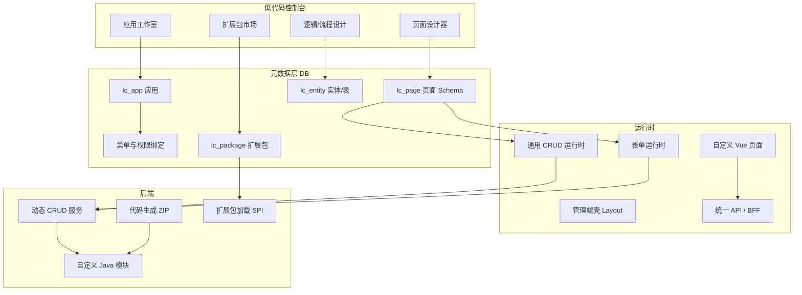

# 低代码技术架构总览

> 目标：在保留「可导出源码、可二次开发」的前提下，逐步支持 **自建应用、表单/列表配置、后端逻辑编排、扩展包**，最终接近企业低代码「一机多应用」体验。

---

## 1. 现状与目标

### 1.1 当前仓库里的三条线（尚未统一）

```
┌─────────────────────────────────────────────────────────────────┐
│                        管理端 / 工具入口                          │
├──────────────┬────────────────────┬───────────────────────────┤
│ 代码生成器    │ 表单设计器 build    │ 骨架工作室 Skeleton        │
│ generator    │ utils/generator     │ components/skeleton        │
│ ZIP → 手工合并│ 导出单页 .vue       │ Schema → HTML/CSS/导出      │
├──────────────┴────────────────────┴───────────────────────────┤
│ 共性：元数据在客户端或 gen_table；运行时仍以「真实 Vue 文件」为主   │
└─────────────────────────────────────────────────────────────────┘
```

**目标态**：元数据在 **应用中心（App Registry）**，运行时由 **通用壳 + Schema** 渲染列表/表单，复杂逻辑走 **扩展包 / 自定义服务**；仍可选 **导出 ZIP** 供离线交付。

### 1.2 为何不做「服务端校验本机 Vue 路径」

- 前后端 **双仓库、多开发者**，绝对路径不可进 Git。  
- 低代码平台通常：**ZIP/CI 合并** 或 **根本不生成源码**。  
- 本项目 P0 选择：**ZIP 照旧 + 发布菜单只写 DB**（见 `02-当前能力与发布菜单.md`）。

---

## 2. 目标架构（分域）



### 2.1 核心概念对照（宜搭 / 通用后台 / 本项目目标）

| 概念 | 宜搭类低代码 | 通用开源后台 | GeekPlus 目标命名 |
|------|--------------|---------------|-------------------|
| 自建应用 | 应用 | 微服务/模块 | `lc_app`（应用） |
| 数据模型 | 表单/实体 | gen_table / 表设计 | `lc_entity` + 复用 `gen_table` |
| 列表页 | 表格组件 | 代码生成 index.vue | `lc_page.type=list` + Schema |
| 表单页 | 详情/表单 | 代码生成 form | `lc_page.type=form` + Schema |
| 菜单 | 应用导航 | sys_menu | 发布时写 `sys_menu`，绑定 `appId` |
| 权限 | 应用角色 | `module:business:action` | 保持 Shiro 前缀契约 |
| 扩展 | 插件市场 | 自定义 jar | `lc_package` + Java SPI / 前端 npm 子包 |
| 导出 | 较少 | ZIP 代码 | 保留 ZIP，与运行时并行 |

---

## 3. 演进阶段（推荐路线）

### 阶段 0 — 已完成方向（P0）

- 表导入 → FreeMarker → **ZIP 下载**  
- **独立接口** `publishMenus`：幂等 + 事务写菜单，**不读盘**  
- 开发者：ZIP 合并 → 本地验证 → 发布菜单 → 刷新权限  

### 阶段 1 — 元数据统一（3～6 周量级）

**目标**：一个「应用」下可配置多页面，仍可用代码生成兜底。

| 能力 | 实现要点 |
|------|----------|
| 应用注册 | 表 `lc_app`：`appId, name, icon, packagePrefix, status` |
| 页面 Schema | 表 `lc_page`：`pageId, appId, type(list\|form\|custom), schemaJson, routePath` |
| 通用列表壳 | `views/admin/lowcode/CrudListRuntime.vue` 读 Schema 渲染 `el-table` + 查询区 |
| 通用表单壳 | `CrudFormRuntime.vue` 读 Schema 渲染 `el-form` |
| 菜单发布 | 菜单 `component` 指向壳：`lowcode/runtime/list?appId=&pageId=` 或统一 `lowcode/page/index.vue` + meta |
| 动态 API | 复用生成器 REST 或新增 `DynamicCrudController`：`/{appId}/{entity}/list` |

**路由策略**（与现有 `permission.js` 兼容）：

```javascript
// 方案 A：单壳 + query（改动小）
component: 'lowcode/CrudRuntime.vue'
meta: { appId: 'book', pageId: 'list' }

// 方案 B：菜单 component 仍像 today
component: 'function/book/index.vue'  // 实为 re-export 壳组件
```

### 阶段 2 — 可视化设计器打通（6～12 周）

- 将 `tool/build` 的字段 Schema 与 `lc_page.schemaJson` 对齐（已有 `utils/generator/html.js` 可产出片段）。  
- 表设计器：前端 DDL 预览 + 后端执行（或仅生成 SQL 人工执行）。  
- 发布流水线：保存 Schema → 可选 ZIP → 发布菜单（一步向导）。  

### 阶段 3 — 逻辑与扩展包（中长期）

| 类型 | 说明 |
|------|------|
| **前端扩展包** | npm workspace / `packages/lc-widgets`：注册自定义组件到设计器与运行时 |
| **后端扩展包** | `lc_package` 记录 jar 坐标；`PluginLoader` 扫描 `@LcExtension` 注册校验器、钩子 |
| **逻辑编排** | 轻量：事件脚本（沙箱 JS）或规则表；重量：对接流程引擎 |
| **多租户** | 与现有 `docs` 中 SaaS 方案叠加：`tenant_id` 写入 `lc_app` |

---

## 4. 元数据 Schema 示例（列表页）

```json
{
  "version": 1,
  "entity": "book",
  "apiPrefix": "/function/book",
  "columns": [
    { "field": "title", "label": "书名", "width": 200 },
    { "field": "author", "label": "作者" }
  ],
  "search": [
    { "field": "title", "component": "input", "label": "书名" }
  ],
  "actions": ["add", "edit", "delete", "export"],
  "permissions": {
    "list": "function:book:list",
    "add": "function:book:add"
  }
}
```

运行时壳职责：

1. 拉取 Schema（或路由 meta 内嵌 id 再请求）  
2. 按 `apiPrefix` 调现有 CRUD API  
3. 按钮显隐走 `v-permission` / 路由 meta.perms  

---

## 5. 后端业务如何挂接

### 5.1 代码生成路径（当前）

```
DB 表 → gen_table → FreeMarker → ZIP
              ↓
    com.geekplus.webapp.{module}.*
              ↓
    @RequiresPermissions("{module}:{business}:*")
```

适合：标准 CRUD、要交付源码的团队。

### 5.2 动态 CRUD 路径（目标）

```
lc_entity → 表名 + 列元数据 → DynamicCrudService
              ↓
    通用 Mapper + 白名单 SQL / MyBatis 动态 XML
              ↓
    权限：appId + entity 映射到 perms 前缀
```

适合：纯配置应用、租户内快速建表。

### 5.3 自定义开发包（自建应用核心）

**后端 Java 包**：

```
com.geekplus.webapp.apps.{appCode}.*
  controller/   ← REST，走统一鉴权
  service/      ← 业务逻辑
  entity/       ← 可仍用 MyBatis
  lc/             ← 可选：注册 LcHook 实现类
```

**前端包**（monorepo）：

```
packages/apps/{appCode}/
  pages/          ← 完全自定义 Vue（不走 Schema）
  widgets/        ← 注册到设计器
  api/            ← 接口
```

**注册方式**：

- 应用表 `lc_app.entryType = codegen | schema | customPackage`  
- `customPackage` 时菜单 `component` 指向包内页面或壳 + `meta.appCode`  

---

## 6. 「一机多应用」部署模型

```
┌──────────────────────────────────────────┐
│ 同一套 GeekPlus-Blog-API + 管理端 SPA      │
├──────────────────────────────────────────┤
│ 平台应用：文章、评论、文件…（原生模块）      │
│ 自建应用 A：lc_app + Schema 页面           │
│ 自建应用 B：ZIP 合并的 function/* 模块       │
│ 自建应用 C：packages/apps/c 自定义 Vue       │
└──────────────────────────────────────────┘
```

- **不**为每个应用单独部署前端；靠 **菜单树 + 权限** 隔离可见性。  
- 后期 SaaS： `lc_app.tenant_id` + 数据权限 `@DataScope`。  

---

## 7. 与现有系统的集成点

| 模块 | 路径 | 低代码中的角色 |
|------|------|----------------|
| 动态路由 | `src/store/modules/permission.js` | 菜单 `component` → `@/views/admin/` |
| 菜单 API | `sys/menu/*` | 发布菜单、应用安装 |
| 代码生成 | `GeekPlus-Blog-API/.../generator` | ZIP + gen_table |
| 表单设计 | `views/admin/tool/build` | Schema 来源 |
| 骨架 | `components/skeleton` | 列表/详情布局模板 |
| 鉴权 | Shiro + `@RequiresPermissions` | Schema.permissions 对齐 |
| 操作日志 | `@Log` → `sys_oper_log` | 发布/安装应用审计 |

---

## 8. 风险与约束

1. **动态 CRUD 安全**：表名/列白名单、防 SQL 注入、禁止操作系统表。  
2. **性能**：大表列表必须分页；Schema 缓存（Caffeine/Redis）。  
3. **版本**：Schema `version` 字段 + 迁移器，避免升级炸页面。  
4. **源码导出**：ZIP 与运行时双轨长期并存，避免绑架开发者路径。  

---

## 9. 相关文档

- 当前 P0 发布菜单：[02-当前能力与发布菜单.md](./02-当前能力与发布菜单.md)  
- 实施步骤：[03-开发实施指南.md](./03-开发实施指南.md)  
- 后端 API 契约：[GeekPlus-Blog-API/docs/15-代码生成发布菜单.md](../../GeekPlus-Blog-API/docs/15-代码生成发布菜单.md)  
- 全栈协作：[docs/v2](../v2/README.md)
