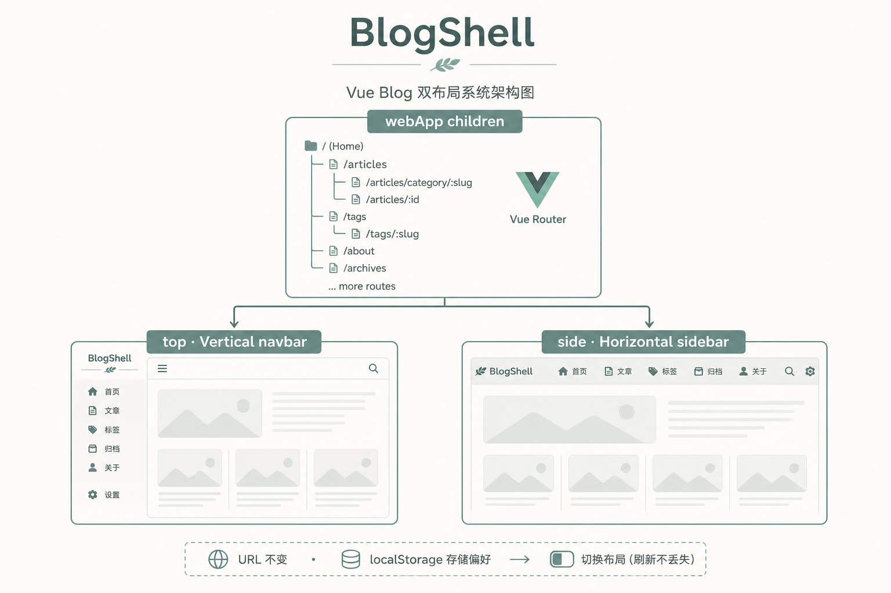
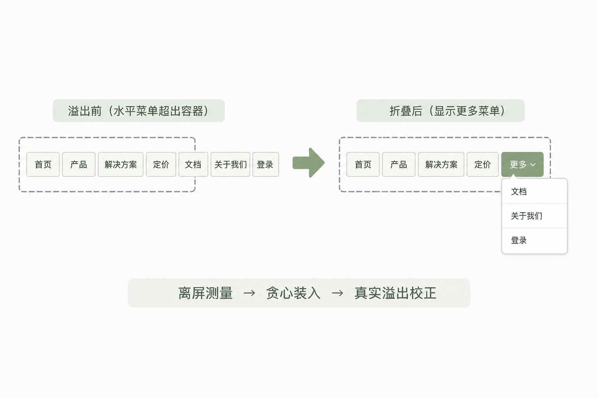
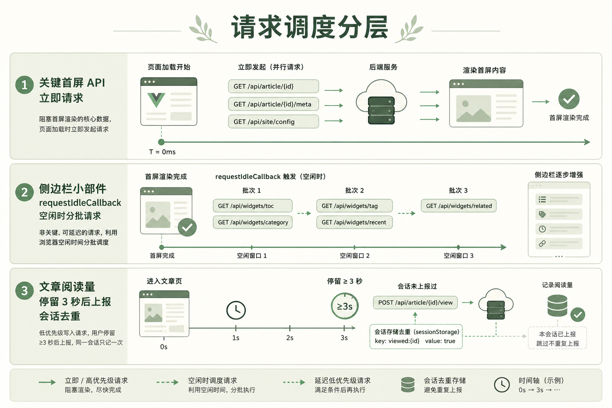
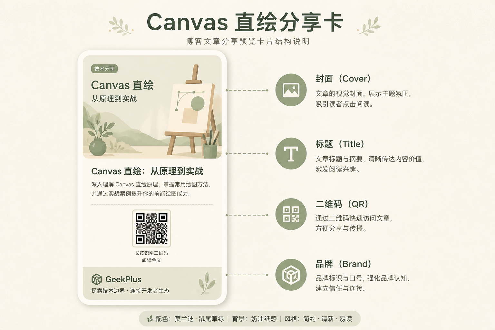

# 从拆路由到 BlogShell：极客普拉斯博客前端的一次「布局 × 导航 × 网络」改造实录

> **已有更完整的第二版分篇系列（推荐发布用）：** [`docs/v2/README.md`](./v2/README.md)  
> 第二版含 **7 篇独立文章**（新增「双重动态路由与守卫」），篇幅与步骤更全。本文保留作合集速览。

> 技术栈：Vue 2 + Vue Router + Vuex + Element UI（管理端）+ 自研 `gp-*` 前台组件  
> 本文对应仓库近期几轮较大改动，按「为什么做 → 踩过什么坑 → 怎么落地 → 关键代码」来写，方便对照源码阅读。

---

## 写在前面

博客站做到一定阶段，前端往往不是「缺功能」，而是**壳子太碎、菜单太挤、请求太猛、体验不统一**。

极客普拉斯（GeekPlus）这阵子集中啃了几块硬骨头：

1. **双布局自由切换**（顶部导航 / 侧栏导航），URL 不变  
2. **横屏菜单溢出折叠到「更多」**（前台 + 后台各一套）  
3. **`request` 与请求调度优化**（少弹错、少并发、浏览量不灌水）  
4. **文章分享卡片**（Canvas 直绘，不靠 DOM 截图）  
5. **首页轮播**（自研 PlusCarousel，摆脱 Element 强绑定）  
6. **导航组件同时服务抽屉 + 桌面横排**（一套数据、两种形态）

下面按模块拆开讲。配图是结构示意；真实效果以线上站点为准。

---

## 一、双布局：从「两套父路由」到 BlogShell

### 1.1 一开始怎么做的，以及为什么难受

早期为了「首页用顶栏、其它页用侧栏」，路由被拆成两棵树：

- `webApp` → Vertical（顶栏）→ 几乎只有首页  
- `sideApp` → Horizontal（侧栏）→ 关于、搜索、文章、动态栏目……

这样能跑，但有三个硬伤：

| 问题 | 体感 |
|------|------|
| 路由分裂 | 动态栏目 `addRoute` 只能挂一边；以后想「首页也侧栏」得搬家 |
| 切换成本高 | 换布局 ≈ 换父路由，URL / keep-alive / 权限守卫都要跟着重写 |
| 心智负担 | 同事改菜单时要先问：这页挂在哪个 App 下？ |

结论很明确：**要自由切换且 URL 不变，就得「单路由树 + 外壳切换」**。

### 1.2 方案选型

我们评估过三种做法：

| 方案 | 结论 |
|------|------|
| 两套父路由复制 children | 翻倍维护，动态菜单注册两次，否决 |
| `/v/*` `/s/*` 前缀切布局 | URL 绑死模板，分享链接不友好，否决 |
| **BlogShell 动态外壳** | 子路由只注册一次，偏好写 localStorage，采用 |

结构示意：



### 1.3 落地步骤（可复现）

1. 抽出 `blogChildrenRoutes`（首页 + 原 sideApp 子路由）  
2. 新建 `BlogShell.vue`，父路由 `name: 'webApp'` 只挂这一份 children  
3. `permission.js` 动态栏目改回 `addRoute('webApp', item)`  
4. `settings.blogLayout = 'top' | 'side'`，经 Vuex + `localStorage` 持久化  
5. 两套 layout 都挂切换入口（顶栏按钮 / 设置浮层）

### 1.4 核心代码

**外壳只做一件事：选组件。**

```vue
<!-- src/layout/blog/BlogShell.vue -->
<template>
  <component :is="layoutComp" />
</template>

<script>
import VerticalBlog from '@/layout/blog/vertical/index'
import HorizontalBlog from '@/layout/blog/horizontal/index'

export default {
  name: 'BlogShell',
  components: { VerticalBlog, HorizontalBlog },
  computed: {
    blogLayout() {
      return (this.$store.state.settings && this.$store.state.settings.blogLayout) || 'top'
    },
    layoutComp() {
      // 命名易混：top → 顶栏 Vertical；side → 侧栏 Horizontal
      return this.blogLayout === 'side' ? 'HorizontalBlog' : 'VerticalBlog'
    }
  }
}
</script>
```

**切换逻辑抽成 mixin，两边 layout 共用：**

```js
// src/layout/blog/blogLayoutMixin.js
export default {
  computed: {
    blogLayout() {
      return (this.$store.state.settings && this.$store.state.settings.blogLayout) || 'top'
    },
    blogLayoutToggleTitle() {
      return this.blogLayout === 'side' ? '切换为顶部导航' : '切换为侧栏导航'
    }
  },
  methods: {
    toggleBlogLayout() {
      const next = this.blogLayout === 'side' ? 'top' : 'side'
      this.$store.dispatch('settings/changeSetting', {
        key: 'blogLayout',
        value: next
      })
    }
  }
}
```

**路由侧（节选）：**

```js
// src/router/index.js（结构示意）
{
  path: '/',
  component: BlogShell,
  name: 'webApp',
  type: 'webApp',
  children: blogChildrenRoutes // 首页、搜索、文章、关于……共享
}
```

**动态栏目挂载：**

```js
// src/permission.js
accessRoutes.forEach((item) => {
  addChildRoute('webApp', item)
})
```

### 1.5 过程里踩过的坑：直链白屏

栏目路由（如 `/timeEssay/personalEssay`）不在静态表里，靠 `navMenu/getMenu` 运行时 `addRoute`。

**现象：** 从首页点菜单能进；**刷新或直开栏目 URL** 有时白屏。

**根因：** 守卫里 `await` 拉完菜单并 `addRoute` 后如果只 `next()`，Vue Router 仍沿用「加路由之前」的匹配结果，`matched` 为空。

**解法：**

1. 本轮刚注册完 → `needRematch: true`  
2. 调用方 `next({ path: to.fullPath, replace: true })` **强制再匹配**  
3. 注意不要 `next({ ...to })` 展开 Route 对象（可能带上内部字段，触发奇怪报错）  
4. 模块加载时预取菜单；`sessionStorage` 缓存（`gp_public_nav_menu`）缩短直链等待

侧栏收起后的子菜单，另用 **fixed 浮层**（挂在 aside 外），避免 `transform` / `overflow` 裁切——这和后面导航下拉是同一类「containing block」问题。

### 1.6 小结

BlogShell 的价值不在「多写一个组件」，而在于：**布局成为偏好，路由回归业务**。线上任意页点切换，地址栏不动，只是壳在换。

---

## 二、横屏菜单溢出：折进「更多」

前台顶栏（`BlogNavMenu`）和后台顶栏（`Topbar`）都遇到过同一句话：

> 「菜单多了就换行 / 把右侧头像挤飞 / 或者干脆横滑一条长龙。」

我们要的是：**单行 + 装不下进「更多」**。



### 2.1 通用算法

两处实现思路对齐：

1. **离屏测量列表**（`position: absolute; left: -9999px`）  
   正式列表在 flex 里会被挤压，量出来的宽度是「假瘦」的；离屏列表按真实文字 + icon 量宽。  
2. **`outerWidth`** = `getBoundingClientRect().width` + 左右 margin  
   只量 content 会少算几像素，最后一项常被「挤出半截」。  
3. **贪心装入**  
   `budget = 容器宽 - 小安全边距`；累加项宽；一旦装不下，还要预留「更多」按钮宽度。  
4. **二次收紧 `tightenUntilFits`**  
   字体 / 图标晚到时宽度会变，渲染后再看一眼是否真溢出。

### 2.2 一个差点把所有菜单「折叠光」的 Bug

第一版二次收紧写成了：

```js
// ❌ 错误思路
overflowed = list.scrollWidth > budget
// budget = avail - SAFETY
```

列表 CSS 往往是 `width: 100%`。内容明明没超，**`scrollWidth` 也会≈ `clientWidth`（整段可用宽）**。  
于是：`scrollWidth(800) > budget(792)` 永远成立 → `visibleCount` 一路减到 0 → **全部进「更多」**。

用户反馈「明明没超出，全折叠了」，就是这个。

**修复：只认真实横向溢出。**

```js
// ✅ BlogNavMenu / Topbar 共用原则
const overflowed = list.scrollWidth > list.clientWidth + 1
if (overflowed && this.visibleCount > 0) {
  this.visibleCount -= 1
  this.$nextTick(run)
}
```

### 2.3 前台：`BlogNavMenu` 关键片段

```js
recompute() {
  if (this.mode !== 'desktop' || !this.$refs.measure) return
  const avail = Math.floor(this.$el.clientWidth || this.$refs.root.clientWidth || 0)
  if (avail <= 0) return

  const budget = Math.max(0, avail - 4)
  const kids = Array.from(this.$refs.measure.children)
  const moreEl = kids[kids.length - 1]
  const itemEls = kids.slice(0, -1)
  this.moreWidth = this.outerWidth(moreEl) || 72
  const widths = itemEls.map((el) => this.outerWidth(el))

  const sumAll = widths.reduce((a, b) => a + b, 0)
  if (sumAll <= budget) {
    this.visibleCount = widths.length
    this.$nextTick(() => this.tightenUntilFits())
    return
  }

  let used = 0
  let count = 0
  for (let i = 0; i < widths.length; i++) {
    if (used + widths[i] + this.moreWidth <= budget) {
      used += widths[i]
      count++
    } else break
  }
  this.visibleCount = Math.max(0, count)
  this.$nextTick(() => this.tightenUntilFits())
}
```

容器侧还用了经典 flex 技巧，避免「子内容把父级撑破」：

```scss
.gp-blog-nav.is-desktop {
  flex: 1 1 0;
  min-width: 0;
  width: 0;      /* 强制按剩余空间分配，而不是按内容最小宽度 */
  max-width: 100%;
}
```

后台 `Navbar` 的 `.left-menu` 原先是 `flex: 1 0 auto`（**不收缩**），Topbar 再怎么算都会被整段顶出去；改成 `flex: 1 1 0; min-width: 0; width: 0` 后，「更多」才真正有空间可算。

### 2.4 后台 Topbar

逻辑同构：离屏测标题宽度 → 切 `primaryRoutes` / `overflowRoutes` → 溢出项塞进 `el-submenu index="__topbar_more__"`。  
测量 padding 对齐 `sidebar.scss` 里顶栏 `padding: 0 6px`，避免「量得过宽 → 过早折叠」。

### 2.5 小结

溢出折叠看起来是 UI 细节，本质是 **测量坐标系选错**。  
离屏测「自然宽」、在线看「是否真溢出」，两步缺一不可；二次收紧千万别拿 `scrollWidth` 去跟人为缩小的 budget 比。

---

## 三、request 与网络优化：少报错、少并发、少灌水



### 3.1 统一请求层想解决什么

`src/utils/request.js` 在 axios 外包一层，重点不是「再封装一遍」，而是：

- 鉴权头统一（`Plus-Token`）  
- 业务码 / HTTP 码统一翻译（`errorCode`）  
- **401 弹窗全局单例**（并发失效时不刷屏）  
- **同文案错误 2.5s 内只提示一次**  
- **默认不重试**（旧逻辑 GET 默认 retry=2，弱网会连弹「超时」）  
- 可选 **in-flight 去重**（同 method+url+params 共用一个 Promise）

### 3.2 核心实现（节选）

```js
// src/utils/request.js
const service = axios.create({
  baseURL: process.env.VUE_APP_BASE_API, // 开发 /dev-api，生产 /pro-api
  timeout: 25000
})

let isReloginShowing = false
let lastTipAt = 0
let lastTipMsg = ''

function tipError(msg, duration = 3000) {
  const now = Date.now()
  if (msg === lastTipMsg && now - lastTipAt < 2500) return
  lastTipMsg = msg
  lastTipAt = now
  Message({ message: msg, type: 'error', duration })
}

function showReloginConfirm() {
  if (isReloginShowing) return
  isReloginShowing = true
  MessageBox.confirm('未登录, 需要重新登录', '退出登录', { /* ... */ })
    .then(() => store.dispatch('user/logout').then(() => { location.href = '/user' }))
    .finally(() => setTimeout(() => { isReloginShowing = false }, 800))
}

async function request(config) {
  const requestKey = getRequestKey(config)
  const maxRetry = typeof config.retry === 'number' ? config.retry : 0

  if (config.deduplicate !== false && pendingRequests.has(requestKey)) {
    return pendingRequests.get(requestKey)
  }

  const runner = (async () => {
    let attempt = 0
    while (true) {
      try {
        return await service({
          ...config,
          __suppressErrorTip: attempt < maxRetry // 中间轮次静默
        })
      } catch (err) {
        attempt += 1
        const canRetry =
          attempt <= maxRetry &&
          ['get', 'head'].includes((config.method || 'get').toLowerCase()) &&
          isRetriableError(err)
        if (!canRetry) throw err
        await sleep(400 * attempt)
      }
    }
  })()

  if (config.deduplicate !== false) {
    pendingRequests.set(requestKey, runner)
    runner.finally(() => {
      if (pendingRequests.get(requestKey) === runner) pendingRequests.delete(requestKey)
    })
  }
  return runner
}
```

开发代理（`vue.config.js`）把 `VUE_APP_BASE_API` 转到 `https://api.xxx.xxx:8443`，本地写 `/geekplusapp/...` 即可。

### 3.3 请求调度：`deferRequest.js`

首屏若同时打轮播、文章流、热门、标签、广告位……弱网下很容易「一半失败一半超时」。

策略对齐常见成熟站：

| 层级 | 做什么 |
|------|--------|
| 关键路径 | 轮播、首屏列表：**立刻请求** |
| 侧栏 / 推荐 | `runWhenIdle` + `runAfter(400/800/1200)` **错峰** |
| 浏览量 | 会话去重 + 停留约 3s + 页隐藏补发 |

```js
// src/utils/deferRequest.js（节选）
export function runWhenIdle(fn, timeout = 2000) {
  if (typeof window.requestIdleCallback === 'function') {
    return window.requestIdleCallback(() => { fn() }, { timeout })
  }
  return window.setTimeout(fn, Math.min(800, timeout))
}

export function scheduleArticleViewCount({ articleId, send, dwellMs = 3000 }) {
  // sessionStorage 标记 gp_viewed_{id}
  // 停留 dwellMs 后再 idle 上报；visibilitychange / pagehide 时补发
}
```

首页桌面端大致是：`created` 里拉轮播和列表；侧栏用 idle / after 错开。文章页侧栏评论同类处理。

### 3.4 小结

网络优化不是堆「黑科技」，而是：

- **默认保守**（不乱重试、错误提示去重）  
- **关键优先**（首屏先活下来）  
- **统计诚实**（浏览量会话内一次）

---

## 四、分享卡片：Canvas 直绘，而不是截 DOM



### 4.1 为什么不用 html2canvas / OG 标签

- **Open Graph**：适合外链爬虫预览；本站分享卡要的是「用户点分享 → 得到一张可保存的图」。  
- **html2canvas**：DOM 样式一复杂就糊、跨域图易污染 canvas，调试成本高。

主路径在 `src/views/article/mobile.vue`（路由 `/article/:id`）：**离屏 canvas 按固定版式绘制 → JPEG dataURL**。

### 4.2 流程

1. 用户打开分享面板 → `toggleShareWith`  
2. `prepareAndGenerateShareCard` 并行加载：封面、Logo、二维码（`qrcode`）  
3. `drawShareCardToDataUrl`：360 宽、dpr=2、JPEG 0.88  
4. 桌面：blob / download；触控：**预览固定用 dataURL**，必要时 Web Share

### 4.3 踩坑与对策

| 坑 | 对策 |
|----|------|
| 跨域封面污染 canvas，`toDataURL` 抛 SecurityError | `fetch`→blob→objectURL，并检测 `canUseImageInCanvas` |
| 接口返回 200 但空文件 | 校验 `blob.size` |
| iOS WebKit：Share / `a[download]` 后 `blob:` 预览长按失效 | 触控端预览坚持 **dataURL**，不依赖 blob 链 |
| 快速连点生成竞态 | `shareGenToken` 递增，过期结果丢弃 |

### 4.4 绘制核心（节选）

```js
drawShareCardToDataUrl({ coverImg, logoImg, qrImg, title, summary, link, brand }) {
  const cssW = 360
  const dpr = 2
  const canvas = document.createElement('canvas')
  // ... 按 dpr 设宽高，ctx.scale(dpr, dpr)
  // 白底 → 圆角封面 → 标题折行 → 摘要 → Logo/品牌 → 二维码 → 链接
  return canvas.toDataURL('image/jpeg', 0.88)
}
```

线上可在任意文章页点分享体验，进入一篇文章后使用分享入口。

---

## 五、轮播：PlusCarousel 自研无缝 loop

### 5.1 为什么自研

Element 的 `el-carousel` 能用，但前台在做 **减 Element 依赖**、统一触控/鼠标拖拽体验时，自研更可控。  
保留 `ElCarouselBanner` 作备用；首页主路径改为 `PlusCarousel`。

### 5.2 无缝原理（和 el-carousel loop 同类）

轨道渲染为：

```text
[最后一张克隆] + 真实 slides + [第一张克隆]
```

- `trackIndex` 指向轨道位置  
- 动画滑到克隆页后，在 `transitionend` **关掉过渡瞬移回真实页**  
- 用户看到的是连续滑动，而不是取模瞬间跳变

### 5.3 首页接入

```vue
<!-- src/views/desktop/IndexView.vue（示意） -->
<div class="index-carousel-wrapper" :class="{ 'skeleton-loading': carouselLoading }">
  <plus-carousel
    mode="desktop"
    :items="carouselList"
    :height="280"
    :interval="3500"
    :touch="false"
    :mouse-drag="true"
    :mouse-wheel="true"
  />
</div>
```

数据：

- `data` 里预置本地默认图，避免接口慢时整块空白  
- `getCarousel()` → `/geekplusapp/getCarousel`  
- 失败或空数组：保留默认图；成功：替换列表并关 skeleton  

兼容字段：`carouselImg/title/link` 与 `img/title/link`。  
移动端开 touch 跟手；桌面可滚轮 / 拖拽 / 箭头。

### 5.4 实现注意

- `mounted` 先 `measure()` 再 `resetToStart()`，避免 `trackWidth=0` 白屏  
- 图片 `@error` 兜底，单张挂了不拖垮整轨  

---

## 六、BlogNavMenu：一套数据，抽屉 + 桌面横排

### 6.1 组件职责

文件：`src/components/BlogNavMenu/index.vue`

| `mode` | 形态 |
|--------|------|
| `desktop` | 顶栏横排 + 溢出「更多」+ 自定义下拉面板 |
| `drawer` | 移动端抽屉竖排，手风琴展开子栏目 |

`menus` 来自 Vuex `addMenuRoutes`（后台栏目树）。  
`allItems` 再拼上固定项：首页、文件中转、留言、关于。

### 6.2 使用方式（Vertical 布局）

```vue
<!-- 桌面 -->
<blog-nav-menu
  mode="desktop"
  :menus="addNavMenuRoutes"
  @navigate="onNavMenuNavigate"
/>

<!-- 抽屉 -->
<blog-nav-menu
  mode="drawer"
  :menus="addNavMenuRoutes"
  :show-admin-entry="!!$store.getters.username"
  @navigate="onNavMenuNavigate"
/>
```

### 6.3 下拉被裁切：backdrop-filter 的坑

早期子菜单用绝对定位塞在顶栏里，表现是：**只能看见顶栏高度内的一截**。

根因有两层：

1. 列表 / 容器 `overflow: hidden` 直接裁切  
2. 顶栏 `backdrop-filter` 会让子级 `position: fixed` 的 containing block 变成顶栏本身，坐标「锁死」在 60px 高的盒子里

**解法：**

1. 模糊层拆到独立 `.navbar-content__bg`，内容层不再带 filter  
2. 下拉改为 **`position: fixed` + `getBoundingClientRect` 贴按钮下方**（`placePanel`）  
3. 「更多」面板右对齐，避免贴边出屏  

```js
placePanel(trigger, alignRight) {
  const rect = trigger.getBoundingClientRect()
  const top = Math.round(rect.bottom + 4)
  if (alignRight) {
    this.panelStyle = {
      top: top + 'px',
      right: Math.max(8, Math.round(window.innerWidth - rect.right)) + 'px',
      left: 'auto',
      transform: 'none'
    }
  } else {
    this.panelStyle = {
      top: top + 'px',
      left: Math.round(rect.left + rect.width / 2) + 'px',
      transform: 'translateX(-50%)'
    }
  }
}
```

这和侧栏收起态的 flyout 子菜单是同一类经验：**需要逃逸的浮层，别困在带 transform / filter / overflow 的祖先里。**

---

## 七、横切经验：这几轮改造串起来看

| 主题 | 关键词 |
|------|--------|
| 布局 | 单路由树、外壳可换、偏好持久化 |
| 菜单 | 离屏测量、真实溢出、flex 可收缩 |
| 网络 | 默认不重试、错误去重、idle 错峰、浏览量会话去重 |
| 分享 | Canvas 直绘、CORS 与 WebKit 细节 |
| 轮播 | 首尾克隆无缝、默认图兜底 |
| 导航 | 双 mode 同数据、fixed 面板躲裁切 |

如果只记三条工程原则：

1. **结构先于皮肤**：布局切换靠路由模型，不靠复制页面。  
2. **测量先于猜测**：菜单能不能放下，用离屏真实宽，而不是「感觉还行」。  
3. **关键路径先活**：首屏请求要少而准；锦上添花的请求往后排。

---

## 八、相关源码索引（仓库内）

| 模块 | 路径 |
|------|------|
| BlogShell | `src/layout/blog/BlogShell.vue` |
| 布局 mixin | `src/layout/blog/blogLayoutMixin.js` |
| 顶栏布局 | `src/layout/blog/vertical/index.vue` |
| 侧栏布局 | `src/layout/blog/horizontal/index.vue` |
| 路由 | `src/router/index.js` |
| 守卫 / 动态栏目 | `src/permission.js`、`src/store/modules/navMenu.js` |
| 前台导航 | `src/components/BlogNavMenu/index.vue` |
| 后台顶栏 | `src/layout/components/Topbar/index.vue` |
| 请求 | `src/utils/request.js`、`src/utils/deferRequest.js` |
| 分享卡 | `src/views/article/mobile.vue` |
| 轮播 | `src/components/PlusCarousel/index.vue` |
| 设置项 | `src/settings.js`、`src/store/modules/settings.js` |

配图目录：`docs/assets/`

---

## 九、结语

这些改动不是一次性「大重构秀」，而是站点用久了之后，把反复踩的坑收成可复用组件和约定：

- 用户可以按习惯切顶栏 / 侧栏；  
- 菜单再多也不挤爆顶栏；  
- 弱网下少一点红字轰炸；  
- 分享出去是一张干净的卡片；  
- 首页轮播跟手、可兜底；  
- 手机抽屉和桌面菜单说同一种「菜单语言」。

欢迎打开 对照本文点一点：切布局、缩窗口看「更多」、进文章生成分享卡、看首页轮播。若你也在维护 Vue 2 老站，希望这份实录能少走一点弯路。

---

*文档来自自极客普拉斯前端工程实践整理，可直接作为博客稿发布；配图为结构示意，正式发文时可换成线上真实截图。*
